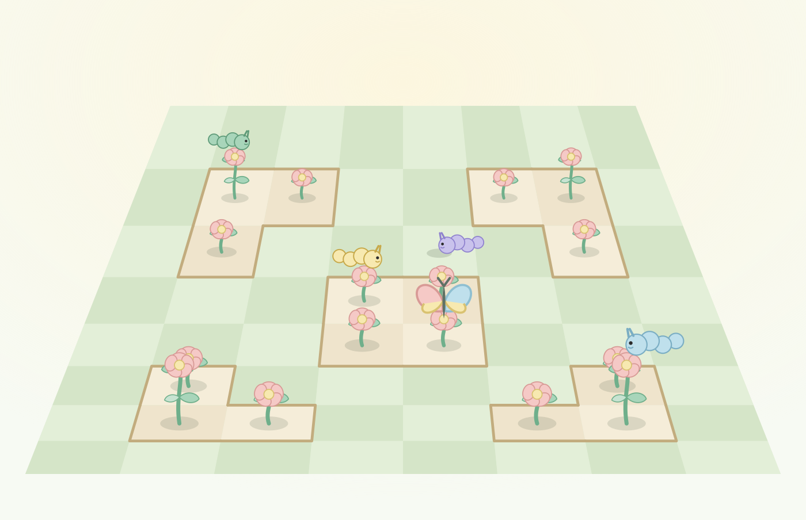
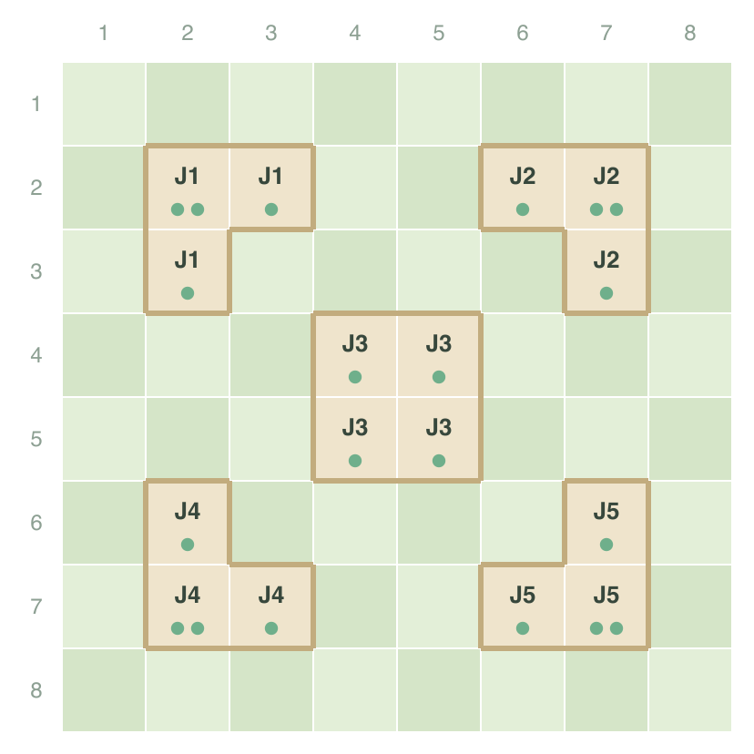
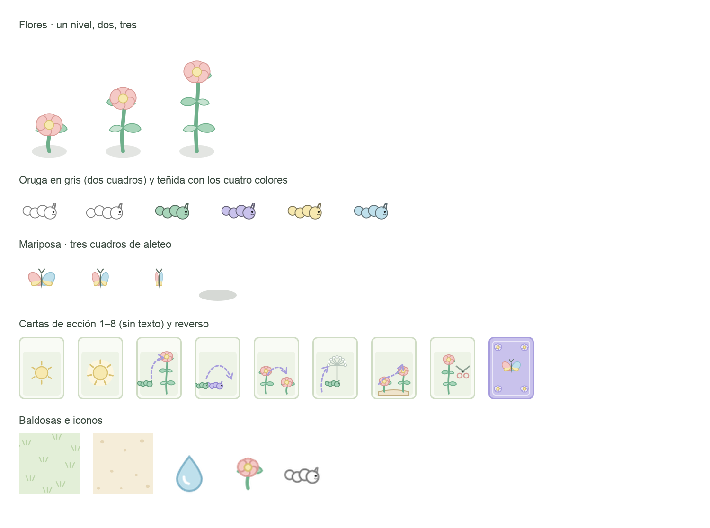

# Análisis · Partida jugable, arte y animaciones

> Versión 1.1 · 3 oct 2026 · Propuesta, **nada implementado en el juego**.
> v1.1: respuestas del usuario a Q-B…Q-G, mapa propuesto (Q-A), propuesta de la carta 6, plan de
> sonido y primera tanda de arte en `docs/arte/`. Lo nuevo está en §10–§13; §2 se conserva como
> estaba para que se vea de dónde salió cada decisión.
> Fuentes: `R` (reglas v3.0), base consolidada §4.8–4.10, `CU-24`/`CU-25`, iteración de despliegue
> y estado vivo, prototipo v3.0 (PT-21…PT-26) y el código de `jbh-develop` en `388bed0`.

---

## 1. Dónde estamos

**Las seis pantallas de partida existen, pero son maquetas fijas.** No hay una sola regla del juego
en código.

| Pieza | Estado real |
|---|---|
| `MatchScreen` | Datos de muestra en constantes (`PreviewClock = "1:12"`, jugadores «jesus», «valentin»…). El tablero es un `Panel` vacío; orugas, construcciones y cartas son cuadros de color. «Terminar turno» salta a `RoundSummary` y luego a `Result`; «Rendirse» abre `Disconnection`, que no es su destino |
| `InitialPlacementScreen` | Pasa sola a la partida a los **3 s** |
| `RoundSummaryScreen` | Pasa sola a la partida a los **5 s** |
| `ResultScreen`, `DisconnectionScreen`, `ResumeScreen` | Maquetas |
| Contratos (`Game.Contracts`) | Solo `IAccountService`, `IRankingService`, `IServerStatusService`. **No hay salas, ni partida, ni canal duplex, ni latido** |
| `Game.Domain` | **No existe.** La iteración de despliegue lo exige: «reglas, puntuación, geometría y desempate; no depende de ninguna otra capa» |
| Recursos gráficos | **Ninguno.** El cliente solo embebe `DejaVuSans.ttf` y el icono. No hay `Content.mgcb` |
| Base de datos | `turn_layout` y `build_allowance` ya cargan las cartas resumen; `match_state.state_document` está listo para el estado en frontera de turno |

**Conclusión:** para que la partida sea jugable faltan cuatro cosas, en este orden de dependencia:
**el motor de reglas → el tablero dibujado e interactivo → la red de partida → el ciclo completo
(rondas, resultado, desconexión)**. El arte y las animaciones van en paralelo desde el segundo paso.

---

## 2. Lo que bloquea antes de escribir una línea

La base consolidada dice que «las reglas no tienen ninguna pregunta abierta». **Para describirlas
es cierto; para programarlas, no.** Al traducir cada regla a una comprobación aparecen huecos que el
código no puede rellenar sin inventar. Se listan sin resolver, con lo que dice cada fuente.

### Q-A · No existe el mapa del tablero `[BLOQUEANTE]`

`R 1.2` dice «distribución fija en todas las partidas» y **nunca la da**. `DR-08` dice que
las jardineras «nacen y quedan delineadas por las construcciones iniciales», pero ninguna fuente dice
cuáles son. El mapa del prototipo está marcado **de ejemplo**. Sin este dato no hay tablero que
cargar, ni puntuación que calcular.

Hace falta: las casillas iniciales con construcción y su altura (8 × 8). Puede vivir como recurso
del dominio (un texto de 8 líneas) o en un catálogo de la base, como `turn_layout`.

### Q-B · ¿Hay orugas a nivel del suelo? `[BLOQUEANTE]`

Las fuentes se contradicen:

- **Sí hay suelo:** `R 2.1` «moverse de casilla a casilla sobre el tablero»; carta 4 «al desplazarse
  … sobre el nivel del tablero»; carta 7 consolidada «subirse al castillo desde el tablero».
- **No hay suelo:** `DR-05` y `CU-25 FA02` colocan la oruga «sobre una flor»; `DR-22` y `FA03`
  dicen que **todo** movimiento ocurre «dentro de la misma jardinera».

Si no hay suelo, las cartas 4 y 7 no tienen jugada posible. Si lo hay, `DR-22` está mal escrita.

### Q-C · ¿La oruga está en la cima de la flor o en un nivel de ella?

La carta 3 sube una oruga «del nivel 1 al nivel 3 **de esa misma flor**», y existe la acción
«Subir · 1» separada de «Mover · 1». Eso implica que **una oruga puede estar en el nivel 1 de una
flor de altura 3**: su posición es *(casilla, nivel)*, no solo *casilla*. Hay que confirmarlo,
porque cambia tres cosas:

- La puntuación `R 4.1` multiplica por «el nivel de la torre en la que se encuentra el caballero»:
  **¿la altura de la flor o el nivel donde está la oruga?**
- El rey `R 4.2` exige «el mismo nivel»: con este modelo la mariposa también tiene nivel.
- El dibujo: la oruga se posa en el par de hojas de su nivel (ver §5), lo que encaja bien.

### Q-D · Qué es exactamente «colocar una construcción»

`R 2.2` y `FA04`: «sobre una jardinera existente, ortogonalmente». Dos lecturas que el código tiene
que distinguir:

1. **Ampliar:** una casilla nueva, vacía, ortogonal a la jardinera (la jardinera crece en superficie).
2. **Apilar:** un nivel más sobre una flor existente (crece en altura, máximo 3 `DR-03`).

`FA04` comprueba «que la flor no supere el nivel 3», lo que sugiere que **las dos valen**. Falta
saber si **se puede apilar sobre una flor ocupada por una oruga** (y si la oruga sube con ella o se
queda en su nivel).

### Q-E · Carta 6, «cambiar de casilla a un caballero»

¿A cualquier flor libre del tablero, aunque sea de otra jardinera? ¿A qué nivel llega? Es la única
carta sin condiciones escritas, y es la que más rompe `DR-22`.

### Q-F · Orden de los turnos dentro de la ronda

`DR-01`: cada jugador tiene N turnos por ronda. Se asume **rotación por puesto de mesa**
(P1·T1, P2·T1, P3·T1, P1·T2…), pero ninguna fuente lo escribe. ¿Empieza siempre el puesto 1, o
empieza quien colocó la mariposa?

### Q-G · Corte de las acciones dentro del turno `[decisión del equipo]`

Es la única cuestión que la base consolidada deja abierta (§5.5). Dos opciones:

| | Cada acción viaja al servidor | El turno viaja entero al pulsar «Terminar» |
|---|---|---|
| Autoridad `RES-05` | El servidor valida cada jugada al momento | El cliente tiene que simular reglas para no dejar hacer jugadas ilegales |
| Los demás ven… | La jugada en vivo | Nada hasta que termina el turno |
| Reconexión `DR-30` | «Acciones ya confirmadas» tiene sentido directo | Habría que guardar el borrador en el cliente |
| Carta robada al azar `DR-06` | El servidor la revela al robarla | No puede resolverse sin el servidor |

**Recomendación: una llamada por acción.** Es la única compatible con `DR-06`, `DR-30` y `RES-05`
sin duplicar reglas en el cliente.

---

## 3. Plan propuesto por fases

Cada fase termina en algo que **se puede jugar o probar**, no en código a medias.

### Fase 1 · Motor de reglas (`Game.Domain` + pruebas)

Biblioteca pura, sin MonoGame, sin WCF, sin base. Es lo que exigen `F-1` y `T-1`.

- **Tablero:** 8 × 8 de `Cell { Height 0–3 }`; jardineras calculadas por relleno ortogonal (las
  diagonales no unen, `R 2.2`).
- **Estado:** puestos, orugas *(casilla, nivel)*, mariposa, mazo y mano por jugador, PA, construcciones
  restantes, ronda/turno, retirados.
- **Una función de validación por acción** que devuelve *legal / motivo*: colocar oruga, mover, subir,
  construir, robar, usar carta 1…8, colocar mariposa. Cada motivo es una clave de texto, para que el
  cliente lo muestre traducido.
- **Puntuación** de ronda y final, **colocador de la mariposa** con desempate al azar, **ganador**
  con `DR-15`.
- **Azar con semilla** inyectada: el robo de cartas y los desempates se reproducen en pruebas.
- **Cartas resumen** como parámetro de entrada (vienen de `turn_layout` y `build_allowance`; el
  dominio no lee la base).
- **Pruebas:** una por regla de `R` y por `DR-`, más una partida completa de 2 jugadores guionizada.

### Fase 2 · Tablero dibujado e interactivo (cliente, contra el motor local)

El tablero se programa **conectado directamente al motor**, sin red, para validar dibujo, selección y
reglas antes de que exista el servidor.

- Un **widget propio de Myra** (`BoardWidget`) que dibuja con el `RenderContext` dentro del hueco que
  hoy ocupa el `Panel` vacío. Así se conserva el resto del diseño de `MatchScreen`.
- **Proyección en escorzo** (§5.2) con su inversa para saber qué casilla está bajo el ratón.
- **Interacción:** elegir acción → se iluminan los destinos legales (los calcula el motor) → clic →
  se aplica. Una jugada ilegal no se aplica y muestra el motivo.
- Sustituir los cuadros de color de la barra lateral y la mano por sprites reales.
- **Arnés de prueba local** (solo compilación Debug): dos o cuatro jugadores en la misma ventana,
  pasando el turno a mano. Es herramienta de desarrollo, **no un modo de juego**; no se ofrece en el
  menú porque no está en los casos de uso.

Al final de esta fase **la partida ya se juega en una sola máquina**, con arte y reglas reales.

### Fase 3 · Red de partida

- **Canal duplex** net.tcp con contrato de callback y la cola que traslada los callbacks al hilo del
  juego (Decisión 6 de la iteración de despliegue). La prueba de concepto ya está verificada.
- **Latido** cliente → servidor. Faltan las cifras (periodo y latidos perdidos); propuesta de
  partida: **2 s y 3 latidos** = 6 s para declarar la caída, a fijar por STK-02 `DR-29`.
- **Salas mínimas** para llegar a la partida: crear sala, unirse por código, lista de jugadores,
  iniciar (solo anfitrión). Chat, expulsión e invitaciones pueden esperar.
- **`IMatchService`:** una operación por acción (Q-G), y callbacks `StateChanged`, `TurnStarted`,
  `RoundClosed`, `MatchEnded`, `PlayerDisconnected`.
- **Reloj del turno en el servidor**; el cliente solo muestra la cuenta atrás que recibe.
- `MatchSetupService` lee las cartas resumen y arma el estado inicial `DR-11`.

### Fase 4 · Ciclo completo

- Colocación inicial real (PT-21), cierre de ronda con puntuación real (PT-23), resultado (PT-24) y
  vuelta a la sala `P-26`.
- Rendirse con confirmación → retiro `DR-25`/`DR-32` (hoy abre la pantalla de desconexión).
- Guardar `match_state` al empezar y al cerrar cada turno `DR-18b`; participaciones al terminar.
- Desconexión, ventana de reconexión y reanudación tras caída (PT-25, PT-26).

### Fase 5 · Pulido

Animaciones secundarias (§6), sonido si se aprueba (§7), ajuste de tiempos.

---

## 4. Inventario de arte

Vocabulario vigente: **oruga** = caballero · **mariposa** = rey · **flor** = torre ·
**jardinera** = castillo · **el jardín** = el tablero. **Ningún número sobre el tablero.**

### 4.1 Tablero

| Recurso | Cantidad | Nota |
|---|---|---|
| Casilla de tierra / césped | 1–3 variantes | Las variantes evitan que el 8 × 8 se vea como cuadrícula |
| Borde de jardinera (obra) | 16 piezas de *autotile* o 4 esquinas + 4 lados | El borde rodea la jardinera entera, no cada casilla: se calcula con los vecinos ortogonales |
| Fondo del jardín | 1 | Lo que hay alrededor del 8 × 8 |
| Iluminación de casilla | 3 | Destino legal · seleccionada · ilegal bajo el ratón |

### 4.2 Piezas

| Recurso | Cantidad | Nota |
|---|---|---|
| Flor, por altura | 3 (nivel 1, 2, 3) | Cada nivel añade un par de hojas al tallo, como en el prototipo. Tallo y flor por separado si se quiere animar el crecimiento |
| Oruga | **1 en escala de grises** | Se tiñe con el color del jugador al dibujar (`Color` del `SpriteBatch`): un solo sprite sirve para los cuatro colores del tema (menta, lavanda, mantequilla, cielo) |
| Oruga, cuadros de animación | 2–4 | Reptar y reposo |
| Mariposa | 2–4 cuadros | Aleteo en reposo |
| Sombra suave | 1 | Bajo orugas y mariposa, da profundidad al escorzo |

### 4.3 Interfaz de la partida

| Recurso | Cantidad | Nota |
|---|---|---|
| Carta, anverso | 8 ilustraciones | **Sin texto dentro de la imagen.** El número y el efecto se escriben encima con la fuente, porque el juego está en español e inglés. Un texto horneado en el PNG obliga a duplicar las 8 cartas por idioma |
| Carta, reverso | 1 | Mazo y cartas de los rivales |
| Iconos de recursos | 2 | Oruga y construcción pequeñas para la barra lateral (pueden ser las mismas piezas escaladas) |
| Marcador de jugador | 4 colores | Hoy son cuadros; PT-07 dice que no hay avatar |

### 4.4 Cómo producirlo

- **Primera tanda desde el prototipo.** `Prototipo-Pantallas-Torres.html` ya dibuja en SVG flores con
  hojas por nivel, orugas y mariposa con el estilo aprobado. Exportarlas a PNG a 2× da arte
  provisional **coherente con lo que el equipo ya vio**, sin esperar a nadie.
- **Formato:** PNG con transparencia, a **2×** del tamaño de dibujo para que se vea nítido en pantalla
  completa y en Retina.
- **Carga:** embebidos y leídos con `Texture2D.FromStream`, igual que hoy se carga la fuente. Evita
  montar el `Content.mgcb` solo para texturas, y mantiene un único mecanismo de recursos.
- **Atlas:** con menos de ~40 imágenes no hace falta; si crece, una sola hoja por grupo.
- **Licencia:** si se usa arte de terceros, solo con licencia que permita uso académico y anotar la
  fuente en el README.

---

## 5. Cómo se dibuja el jardín

### 5.1 Restricción de partida

El usuario rechazó la matriz con números y las cajas: el tablero va **en escorzo, con la temática**.
MonoGame no trae escena 3D lista; se resuelve en 2D.

### 5.2 Propuesta: perspectiva simulada con una función

- Cada casilla *(fila, columna)* se proyecta a un trapecio: las filas del fondo más estrechas y
  más juntas, las del frente más anchas. Es una sola función `Project(fila, col) → (x, y, escala)`.
- Las piezas se dibujan **de fondo a frente** (orden por fila) y se escalan con la fila.
- **Altura:** la flor sube en pantalla según su nivel; la oruga se posa en el par de hojas de su
  nivel (encaja con Q-C).
- **Selección:** se invierte la proyección para saber la casilla bajo el ratón; si hay flor alta
  delante, gana la pieza más cercana al frente.
- Descartadas: **isométrico en rombo** (no es lo que se aprobó en el prototipo) y **3D real**
  (modelos, cámara y sombreadores para un tablero de 64 casillas: coste sin retorno).

---

## 6. Animaciones

Un **sistema de interpolación propio** (posición, escala y opacidad a lo largo del tiempo, con
suavizado) cubre todo. No hace falta librería.

| Prioridad | Animación | Por qué |
|---|---|---|
| **Imprescindible** | Iluminar destinos legales al elegir acción | Sin esto no se sabe qué se puede hacer |
| **Imprescindible** | Pieza seleccionada y casilla bajo el ratón | Retroalimentación básica |
| **Imprescindible** | Jugada ilegal: sacudida breve + motivo | El motor devuelve el motivo; hay que mostrarlo |
| **Imprescindible** | Aviso de cambio de turno («Te toca» / «Turno de …») | Los demás juegan mientras esperas |
| **Imprescindible** | Reloj en sus últimos 10 s (color y pulso) | El turno se pierde sin aviso si no |
| Recomendable | Oruga que repta hasta el destino | Los rivales entienden qué se movió |
| Recomendable | Flor que crece un nivel (hojas que brotan) | Idem para construcciones |
| Recomendable | Mariposa aleteando y volando a su flor | Hace visible la colocación del rey |
| Recomendable | Robar carta: sale del mazo y se voltea | Refuerza que es al azar |
| Recomendable | Puntos que cuentan hacia arriba en el cierre de ronda | PT-23 |
| Opcional | Pétalos o destellos al puntuar, transición entre pantallas | Decoración |

**Regla:** ninguna animación bloquea la entrada ni retrasa el estado. El servidor manda el estado
nuevo y el cliente lo anima; si llega otro cambio a mitad, la animación se completa al instante.

---

## 7. Sonido

**No aparece en ninguna fuente**, ni dentro ni fuera de alcance (§4.11 no lo menciona). Si se quiere,
bastan 6–8 efectos (colocar, mover, crecer, robar, turno, fin de ronda, aviso de reloj) y un
silenciador. **Requiere decisión**; no se añade por defecto.

---

## 8. Orden recomendado y qué puede ir en paralelo

```
Q-A…Q-G resueltas ─► Fase 1 motor ─► Fase 2 tablero ─► Fase 3 red ─► Fase 4 ciclo ─► Fase 5
                         │                ▲
                         └─ Arte §4 ──────┘   (empieza ya, con la exportación del prototipo)
```

- **Ya se puede empezar sin esperar respuestas:** exportar el arte provisional del prototipo, la
  proyección en escorzo del `BoardWidget` y el esqueleto de `Game.Domain` con las partes que no
  dependen de Q-A…Q-E (cartas resumen, PA, mazo, orden de rondas, desempates).
- **Lo primero que conviene cerrar con el equipo:** Q-A (mapa) y Q-B (suelo). Sin ellas no hay
  puntuación ni movimiento.

---

## 9. Estado de las preguntas

| # | Pregunta | Estado al 3 oct 2026 |
|---|---|---|
| Q-A | Mapa fijo | **Propuesta** en §10, a validar por el equipo |
| Q-B | ¿Orugas en el suelo? | **Resuelta: sí** |
| Q-C | ¿Nivel de la oruga dentro de la flor? | **Resuelta: la oruga está siempre en lo alto de la flor**, nunca en un nivel intermedio |
| Q-D | ¿Qué es construir? | **Resuelta: las dos cosas**, añadir un nivel a una flor o poner una flor nueva en una jardinera |
| Q-E | Carta 6 | **Propuesta** en §12 |
| Q-F | Orden de turnos | **Resuelta: cada ronda empieza por el puesto de mesa 1** y sigue en orden de puesto |
| Q-G | Corte de acciones | **Resuelta: una llamada por acción** |
| — | Latido | **Propuesta: 2 s × 3** latidos perdidos = 6 s para declarar la caída |
| — | Sonido | **Resuelta: sí** → §13 |
| — | Arte | **Primera tanda dibujada** → §14 |

---

## 10. Mapa propuesto (Q-A)





Cada punto verde es un nivel de flor. `J1`…`J5` son las cinco jardineras.

```
      1 2 3 4 5 6 7 8          alturas
  1   . . . . . . . .          . . . . . . . .
  2   . J1J1. . J2J2.          . 2 1 . . 1 2 .
  3   . J1. . . . J2.          . 1 . . . . 1 .
  4   . . . J3J3. . .          . . . 1 1 . . .
  5   . . . J3J3. . .          . . . 1 1 . . .
  6   . J4. . . . J5.          . 1 . . . . 1 .
  7   . J4J4. . J5J5.          . 2 1 . . 1 2 .
  8   . . . . . . . .          . . . . . . . .
```

### 10.1 Cuántas jardineras

**Ninguna regla fija el número.** Lo acotan la geometría y el juego:

- **Por arriba, la geometría.** Las jardineras no pueden tocarse ortogonalmente `R 2.2` y tienen que
  poder crecer. Se probaron tres densidades con `docs/arte/verificar-mapa.py`:

  | Jardineras | Resultado |
  |---|---|
  | **9** (esquinas + bordes + centro) | Las de esquina quedan encajonadas: **una sola casilla** donde crecer |
  | **6** (esquinas + dos centrales en diagonal) | Crecen bien, pero dos esquinas tienen **4** casillas de territorio y las otras dos **7**: el mapa favorece un lado |
  | **5** (cuatro esquinas + centro) | **Equilibrado**: territorio 10 · 10 · 8 · 10 · 10, y de 7 a 8 casillas donde crecer cada una |

- **Por abajo, el juego.** Cada jugador tiene **5 orugas** y solo puntúa una jardinera si tiene **una
  única oruga propia** en ella `R 4.1`. Con 5 jardineras, **cada oruga tiene una jardinera que
  disputar**: con más, sobran jardineras que nadie puede cubrir; con menos, sobran orugas.

### 10.2 Lo que cumple

Comprobado con el script:

- **Simetría de 90°**: el jardín es igual visto desde cualquier lado, así que ningún puesto de mesa
  empieza mejor situado.
- **Ninguna jardinera toca a otra ortogonalmente**; las esquinas interiores de `J1`…`J5` están en
  diagonal con el borde del centro, que `R 2.2` permite.
- **Cada jardinera es un solo bloque** `DR-08` y **tiene al menos una flor de nivel 1 junto al suelo**:
  una oruga del suelo siempre puede subir a cualquiera de ellas (sube un solo nivel `R 2.1`).
- **El suelo queda conectado** (48 casillas): se puede cruzar el jardín entero a pie.
- **16 flores iniciales**: sobran para las cuatro orugas de la colocación inicial `DR-05` y la mariposa.

### 10.3 Dónde está el juego

Al principio no hay ninguna casilla de frontera. **Las carreras aparecen al crecer**: si `J1` pone una
flor en la casilla (2,4), la casilla (2,5) queda pegada a `J1` y a `J2` y **ninguna de las dos podrá
crecer ya por ahí**. Lo mismo entre cada esquina y el centro. Quien construye primero cierra el paso
al otro, que es la tensión que piden `R 2.2` y `DR-07`.

El centro empieza con **más superficie (4) pero toda a nivel 1**; las esquinas, con **menos superficie
(3) pero una flor de nivel 2**. Es una decisión, no un accidente: el centro da 4 puntos (4 × 1) y se sube
desde cualquier lado; la flor alta de una esquina da 6 (3 × 2), pero desde el suelo hay que pasar
antes por la de nivel 1, así que cuesta un movimiento más.

---

## 11. Lo que se sigue de las respuestas

Las respuestas cierran Q-B, Q-C, Q-D, Q-F y Q-G, pero **obligan a releer otras reglas**. Se marca qué
se deduce directamente y qué es propuesta.

### 11.1 Posición y movimiento

| | Regla | Origen |
|---|---|---|
| 1 | Una oruga está **en el suelo (nivel 0) o en lo alto de una flor** (nivel = altura de la flor) | Respuesta Q-B y Q-C |
| 2 | **Moverse es ir a una casilla ortogonal contigua.** `R 2.1` dice «de casilla a casilla» sin aclarar; se propone ortogonal por coherencia con `R 2.2` | **Propuesta** |
| 3 | Se sube **un solo nivel** por movimiento y se baja cualquier cantidad: del suelo solo se sube a flores de nivel 1, y de una flor se puede saltar al suelo | `R 2.1` |
| 4 | Coste: **1 PA por moverse + 1 por cada nivel que sube**. Subir del suelo a una flor de nivel 1 cuesta **2** | `R 3.2`, `CU-25 FA03` |
| 5 | **Entre flores, todo movimiento queda dentro de la misma jardinera** sin necesidad de comprobarlo: dos jardineras nunca son contiguas ortogonalmente, así que no hay paso directo de una a otra. Para cambiar de jardinera **hay que bajar al suelo** | Se deduce de `R 2.2` + regla 2 |

**Consecuencia para `DR-22`.** Sigue siendo cierta para el movimiento entre flores, pero su redacción
(«todo movimiento ocurre dentro de la misma jardinera») excluye el suelo. Habría que reescribirla.

**Consecuencia para «Subir · 1».** Si la oruga está siempre en lo alto, **subir no es una acción
aparte**: es el recargo de un movimiento hacia una flor más alta. Se propone **quitar el botón
«Subir»** y que «Mover» muestre en cada destino su coste real (1 o 2). Afecta a `CU-25` (paso 3 y
`FA03`), a PT-22 del prototipo, a `MatchScreen` y a la clave `Match.GrowActionButton` del
diccionario. **No se ha tocado ninguno de esos documentos**; quedan señalados para el equipo.

### 11.2 Construcción

| | Regla | Origen |
|---|---|---|
| 1 | Construir es **añadir un nivel a una flor** (hasta 3 `DR-03`) **o poner una flor nueva** en una casilla de suelo ortogonal a una jardinera | Respuesta Q-D |
| 2 | La flor nueva no puede quedar ortogonal a otra jardinera `R 2.2` | `R 2.2` |
| 3 | **No se construye sobre una flor con oruga**, ni se pone flor nueva en una casilla con oruga. Si se permitiera, la oruga subiría un nivel gratis, más barato que moverse, y además las cartas 5 y 8 ya exigen nivel desocupado | **Propuesta** |
| 4 | **Sí se construye sobre la flor de la mariposa**, y la mariposa sube con ella. Cambia quién cobra su bono `R 4.2`: es una jugada táctica legítima | **Propuesta** |

### 11.3 Cartas que cambian de lectura

| Carta | Con la oruga siempre en lo alto |
|---|---|
| **3** | `CU-25 FA06` dice «al nivel 3 **de esa misma flor**», que ya no es posible. Nueva lectura: **una oruga en una flor de nivel 1 pasa a una flor contigua de nivel 3 de la misma jardinera**. Sigue siendo la única excepción a subir un nivel y sigue sin costar PA |
| **4** | En el suelo, **salta una casilla ocupada** en línea recta y cae en la siguiente. Cuesta lo que un movimiento: **1 PA** *(propuesta)* |
| **7** | Lleva una oruga **a cualquier flor libre de la jardinera donde está**, aunque no sea contigua; si está en el suelo, a cualquier flor libre de una jardinera que toque su casilla. **Sube como mucho un nivel**: `R 2.1` dice que la carta 3 es la *única* excepción, así que la frase consolidada «sin importar el nivel» choca con `R` y debería corregirse. Cuesta 1 PA + 1 si sube |
| **5 y 8** | Sin cambios: actúan sobre el nivel más alto de una flor desocupada |

### 11.4 Puntuación y mariposa

- Un jugador puntúa una jardinera con **superficie × altura de la flor donde está su oruga** `R 4.1`.
  Como la oruga está siempre arriba, ya no hay dos lecturas.
- **Una oruga en el suelo no está en ninguna jardinera**: no puntúa y no cuenta para «un único
  caballero propio».
- Bono de la mariposa `R 4.2`: oruga **en la misma jardinera y en una flor de la misma altura** que la
  flor de la mariposa. **Una oruga puede compartir flor con la mariposa** (la mariposa no es un
  caballero), y entonces cobra.

### 11.5 Ciclo de turnos

- Cada ronda: puesto 1, puesto 2, … puesto N, y vuelta a empezar hasta agotar los turnos de la carta
  resumen. **Cada ronda empieza otra vez por el puesto 1.** Los puestos retirados se saltan `DR-09`.
- La mariposa se coloca **antes** del primer turno de la ronda (ronda 1: último puesto `DR-24`;
  siguientes: menor puntuación `R 2.3`).

---

## 12. Carta 6 · «Permite cambiar de casilla a un caballero» (Q-E)

Es la única carta de `R` sin condiciones. Tres lecturas posibles:

| Lectura | Qué hace | Problema |
|---|---|---|
| **A · Trasladar** *(recomendada)* | Lleva **una oruga propia a cualquier casilla libre del jardín** —suelo o lo alto de una flor libre, de cualquier jardinera—, sin necesidad de que sea contigua. **Sube como mucho un nivel** respecto a donde estaba. **0 PA** | Ninguno: es la única carta que cruza el jardín de golpe, y no pisa a la 3 (subir dos niveles), a la 4 (saltar en el suelo) ni a la 7 (moverse dentro de una jardinera) |
| B · Intercambiar | Cambia de sitio una oruga propia con otra, propia o ajena | «Cambiar de casilla **a un** caballero» habla de uno solo; mover orugas ajenas no aparece en ninguna otra regla |
| C · Teletransporte libre | Como A, pero a cualquier altura | Rompe `R 2.1`: la carta 3 dejaría de ser la única excepción |

La ilustración de la carta 6 está dibujada para la lectura A: una oruga que viaja colgada de un
vilano de diente de león, llevada por el viento.

---

## 13. Sonido

Aprobado. Propuesta de efectos, todos cortos (< 1 s) salvo el aviso de victoria:

| Evento | Carácter |
|---|---|
| Colocar oruga | «Pop» suave |
| Mover | Arrastre corto, como hojas |
| Subir a una flor más alta | Dos notas ascendentes |
| Construir (nivel o flor nueva) | Brote: «plop» + campanita |
| Robar carta | Papel que se desliza |
| Usar carta | Destello |
| Jugada no válida | Golpe sordo, grave |
| Te toca | Campanilla de dos notas |
| Últimos 10 s del reloj | Tic suave, uno por segundo |
| La mariposa se posa | Aleteo |
| Fin de ronda | Arpegio corto |
| Fin de partida | Melodía breve (ganar / perder) |
| Mensaje de chat | «Pop» muy bajo |

- **Formato:** WAV mono de 16 bits, embebido y cargado con `SoundEffect.FromStream`, como la fuente y
  las texturas.
- **Control:** un botón de **silenciar** en la partida, recordado como la preferencia de idioma. **No
  se añade pantalla de ajustes**: `PU-15` prohíbe rellenar «Configurar cuenta» con opciones inventadas.
- **Música de fondo:** opcional y para el final; no se incluye en el plan base.
- **Origen:** paquetes con licencia CC0 (dominio público), o sintetizados por código como provisionales
  igual que el arte.

---

## 14. Arte · primera tanda

Dibujado por código a partir del estilo del prototipo, para que se vea igual que lo que el equipo ya
aprobó. Todo está en `docs/arte/` y **no está conectado al cliente**.



| Archivo | Tamaño (PNG a 2×) | Ancla al dibujar |
|---|---|---|
| `flor-nivel-1/2/3.png` | 128 × 256 | Base del tallo en (64, 240) |
| `oruga-gris-1/2.png` | 112 × 64 | Punto de apoyo en (44, 55). **Se tiñe** con el color del jugador |
| `mariposa-1/2/3.png` | 96 × 96 | Centro |
| `sombra.png` | 96 × 32 | Centro, bajo orugas y mariposa |
| `carta-1…8.png`, `carta-reverso.png` | 96 × 132 | Mismo tamaño que `MatchLayout.CardWidth/Height` a 2×. **Sin texto**: el número va arriba a la izquierda y lo escribe el cliente |
| `baldosa-cesped.png`, `baldosa-tierra.png` | 128 × 128 | Repetibles |
| `icono-pa.png`, `icono-construccion.png`, `icono-oruga-gris.png` | 48 × 48 | Centro |

**Cómo se generan:** `python3 docs/arte/generar-arte.py` escribe los SVG en `svg/` y los rasteriza
con `rsvg-convert`; `componer-lamina.py` arma la lámina. Cambiar un color o una forma es cambiar el
script y volver a lanzarlo.

**Ilustraciones de las cartas:** 1 y 2 = un sol con **6 y 7 rayos** (los PA que dan, sin texto) ·
3 = oruga que salta dos niveles · 4 = oruga que salta a otra · 5 = un nivel que pasa de una flor a
otra · 6 = oruga llevada por un vilano · 7 = recorrido por dentro de la jardinera · 8 = tijeras de
podar.

**Límite honesto:** es ilustración vectorial plana. Para un acabado más rico (texturas, trazo a mano)
hará falta una pasada de una persona en Figma o similar; estos PNG sirven de plantilla de tamaños y
anclas para que esa pasada encaje sin tocar código.

**El suelo del jardín no se dibuja con sprites.** `SpriteBatch` solo dibuja rectángulos, y en escorzo
cada casilla es un trapecio. Se dibuja con primitivas (`VertexPositionColorTexture` + `BasicEffect`),
usando las baldosas como textura; las piezas sí son sprites.
